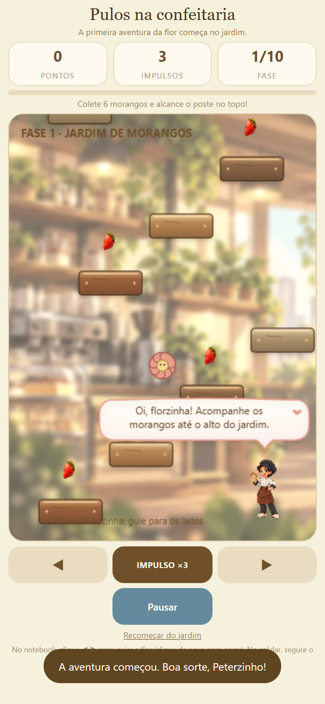
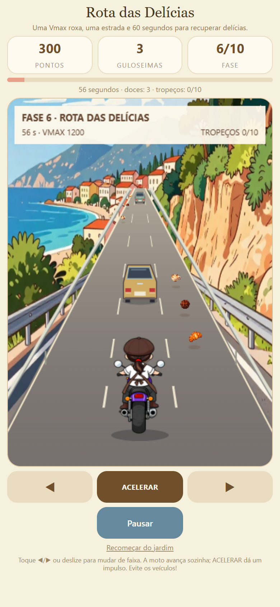

<div align="center">

# Nucífera: Em Busca das Delícias

### Uma pequena aventura. Um grande carinho.

**Protótipo gratuito para Android · Dia das Crianças 2026 · Projeto social**

<p>
  
  
  
  
</p>

**[BAIXAR O APK](https://github.com/bobbygodias/Nucifera-Em-Busca-das-Delicias/releases/download/v0.1.7-prototipo/Nucifera-0.1.7-prototipo.apk)** &nbsp; · &nbsp; **[VER RELEASES](https://github.com/bobbygodias/Nucifera-Em-Busca-das-Delicias/releases)** &nbsp; · &nbsp; **[CONHECER A HARMONIE](https://www.instagram.com/harmoniecafeeconfeitaria/)**

*Dez regiões, guloseimas perdidas e uma confeitaria esperando por você.*

</div>

---

## Uma aventura feita para compartilhar

**Nucífera: Em Busca das Delícias** nasceu como uma iniciativa social para o **Dia das Crianças de 2026**: oferecer uma brincadeira gratuita, acolhedora e acessível para crianças e famílias, inspirada no universo da confeitaria.

O projeto foi idealizado e desenvolvido por **Bobby Dias Developer**, com criação de personagens, cenas, vídeos e sonoplastia para dar vida a esse pequeno mundo. É uma versão de demonstração, feita com tempo e recursos limitados, para celebrar a data e compartilhar a alegria de jogar.

**Este é um protótipo em desenvolvimento.** A proposta é se divertir com o que já está pronto e conhecer a ideia de uma aventura que pode crescer no futuro.

## A missão do Peterzinho

Os Gulosos espalharam as delícias da confeitaria! Peterzinho parte para recuperar os doces, atravessando dez regiões e contando com a ajuda da Sarinha pelo caminho.

| Na aventura | O que você encontra |
| :--- | :--- |
| **Dez fases** | Plataformas, obstáculos, guloseimas e caminhos escondidos. |
| **Um paninho valente** | Pulos e ataques com a toalha para enfrentar os Gulosos. |
| **Rota das Delícias** | Uma fase especial de moto: três pistas, trânsito, turbo e 60 segundos para coletar doces. |
| **Uma história com carinho** | Abertura em camadas, vídeo de apresentação e três finais conforme a pontuação. |
| **Música e sonoplastia** | Vinhetas, trilhas das fases e efeitos para acompanhar a aventura. |
| **Seu próprio desafio** | Ranking pessoal guardado no aparelho, com apelido e melhores resultados. |

<div align="center">
  
  &nbsp;
  
</div>

## Baixe e jogue

1. Abra o **[download do APK](https://github.com/bobbygodias/Nucifera-Em-Busca-das-Delicias/releases/download/v0.1.7-prototipo/Nucifera-0.1.7-prototipo.apk)** ou a página de **[Releases](https://github.com/bobbygodias/Nucifera-Em-Busca-das-Delicias/releases/latest)**.
2. No Android, abra o arquivo baixado. Se o sistema solicitar, autorize a instalação pela aplicação usada para abrir o APK.
3. Inicie **Nucífera** e aproveite a aventura!

O jogo funciona em **Android 5.0 ou posterior**. Pode ser usado em celulares e tablets, com rotação livre; o campo de jogo mantém suas proporções verticais.

<div align="center">

### Aponte a câmera e baixe o jogo

<a href="https://github.com/bobbygodias/Nucifera-Em-Busca-das-Delicias/releases/download/v0.1.7-prototipo/Nucifera-0.1.7-prototipo.apk"></a>

[QR em PNG](docs/media/qr-download.png) · [QR vetorial em SVG](docs/media/qr-download.svg)

</div>

## Harmonie Café e Confeitaria

A **Harmonie Café e Confeitaria**, no **Setor Sul, em Goiânia (GO)**, é o espaço que inspira esta homenagem à confeitaria e aos seus pequenos visitantes. A Nucífera faz parte desse universo de doces, cuidado e encontros.

O jogo leva um pouco desse ambiente para o celular: uma iniciativa para aproximar famílias, despertar sorrisos e celebrar o Dia das Crianças também pela brincadeira.

<div align="center">

**[INSTAGRAM](https://www.instagram.com/harmoniecafeeconfeitaria/)** &nbsp; · &nbsp; **[CARDÁPIO](https://harmoniecafeeconfeitaria.menudino.com/)** &nbsp; · &nbsp; **[COMO CHEGAR](https://www.google.com/maps/place/Harmonie+Caf%C3%A9+e+Confeitaria/@-16.6805798,-49.2492245,17z/data=!4m15!1m8!3m7!1s0x935ef1267c30ab93:0x5dcd3c0b4319250a!2sHarmonie+Caf%C3%A9+e+Confeitaria!8m2!3d-16.6805798!4d-49.2492245!10e1!16s%2Fg%2F11z80t32vq!3m5!1s0x935ef1267c30ab93:0x5dcd3c0b4319250a!8m2!3d-16.6805798!4d-49.2492245!16s%2Fg%2F11z80t32vq!18m1!1e1)**

</div>

## Jogar com tranquilidade

- **Gratuito**, sem anúncios e sem compras dentro do jogo.
- **Offline**: fases, músicas e vídeos estão incluídos no aplicativo.
- **Sem cadastro**: o ranking é pessoal, salvo apenas no aparelho.
- **Sem servidor de pontuações** ou integração com serviços Google.
- Botão **Pausar** durante a partida; os controles são feitos para toque.

Os links para conhecer a confeitaria são externos. O apelido e o ranking ficam no armazenamento local do aplicativo; desinstalá-lo remove esses dados.

## Para quem quer conhecer o projeto

Este repositório reúne **o código e os recursos usados no APK aprovado, versão 0.1.7**. O aplicativo Android contém o jogo em HTML, CSS e JavaScript e reproduz os vídeos internamente.

```text
index.html          Interface e abertura
game.js            Fases, áudio, pontuação e fluxo do jogo
motorcycle.js      Fase especial da moto
assets/            Artes e vídeos utilizados nesta versão
android/           Aplicativo Android e configuração de compilação
docs/              Guia de compilação e material de apresentação
```

**[Como compilar](docs/COMPILAR.md)** · **[Notas da versão](CHANGELOG.md)** · **[Licença MIT](LICENSE)**

O APK instalável fica em **Releases**. O repositório contém apenas a versão atual do projeto e seu material de apresentação.

---

<div align="center">

**Idealização, direção criativa e desenvolvimento: Bobby Dias Developer**

Criado com auxílio de inteligência artificial na programação e na produção de conteúdo, com direção e revisão humana.

**Feito com carinho para o Dia das Crianças.**

*Qapla’!*

</div>
